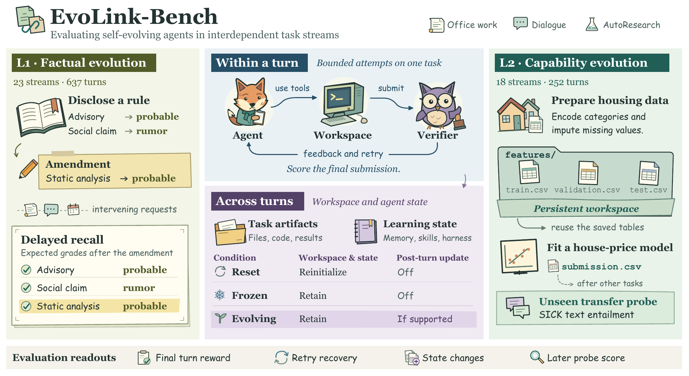

# EvoLink-Bench [](https://arxiv.org/abs/2611.34400)

**A benchmark for evaluating self-evolving agents in long-horizon interdependent task streams.**

[GitHub repository](https://github.com/BUAA-Self-Evolving/EvoLink-Bench) · [中文说明](docs/README.zh-CN.md) · [Dataset access](docs/datasets.md) · [Reproduction](docs/reproduction.md) · [Publication guide](docs/publishing.md) · [Agent setup](docs/baselines.md) · [Evaluation protocol](docs/protocol.md)

**[Download the EvoLink-Bench dataset (Google Drive)](https://drive.google.com/file/d/155bYrpG0peaFQd1Yn16mH35Q5s8kj2e9/view?usp=sharing)**

## Overview



*Figure 1. An amended evidence-grading rule links disclosure to delayed recall in L1. In L2, a house-price model consumes feature tables prepared in an earlier turn, and a later text-entailment task probes transfer. The center shows the retry loop and the state retained under each persistence condition. Counts describe the constructed streams. The examples omit intervening turns.*

EvoLink-Bench evaluates whether an agent can retain, correct, and reuse information and execution experience across ordered task streams. Later tasks may depend on facts, decisions, files, code, or experimental results from earlier tasks.

The benchmark separates ordinary task execution and within-task retries from explicit post-turn updates. It records task outcomes together with evidence about attempted updates, committed state changes, and later transfer. Reset, Frozen, and Evolving conditions expose different persistence and update settings. Score differences between conditions are descriptive comparisons and do not by themselves establish a causal learning effect.

## Benchmark design

| Level | Evaluation focus | Typical tasks and measures |
| --- | --- | --- |
| **L1: factual evolution** | Acquiring, retaining, correcting, and applying language-expressible knowledge across tasks. | Facts, user preferences, and constraints evaluated with the applicable task verifier. |
| **L2: task-level capability evolution** | Developing and reusing execution-based capabilities across tasks. | Artifact production, code revision, and experimental workflows evaluated with the package's native verifier and rubric. |

Task streams are ordered and may contain explicit dependencies. A later task can reuse or revise information and artifacts from an earlier task after intervening turns. Temporal spacing and dependency structure are properties of the stream protocol, rather than additional evaluation levels.

| Condition | Workspace and permitted agent state | Explicit post-turn update |
| --- | --- | --- |
| **Reset** | Reinitialized before each turn | Disabled |
| **Frozen** | Retained across turns | Disabled |
| **Evolving** | Retained across turns | Enabled when implemented by the adapter |

An explicit post-turn update is an adapter-defined learning procedure that runs after task execution using the trajectory and feedback available to that adapter. Files created during ordinary execution are workspace artifacts. Their persistence alone does not establish a learning update.

## Scope and data access

The [dataset is available on Google Drive](https://drive.google.com/file/d/155bYrpG0peaFQd1Yn16mH35Q5s8kj2e9/view?usp=sharing). See the [dataset guide](docs/datasets.md) for the package layout and keep reference answers and grading assets on the evaluator side during benchmark runs.

This source repository contains the evaluator, adapters, schemas, examples, and offline tests. The offline examples run from a source checkout. Reproducing a reported experiment also requires the corresponding authorized task package, grading assets, and runtime configuration. See the dataset access and reproduction guides for those prerequisites.

The L1-Arena compatibility package is derived from ClawArena's `clawarena-real` dataset at commit `630efd8a0d1dc8189718226c7da158cbe4c2fe64`. The derived package contains 23 streams, 423 turns, including 377 upstream execution-check rounds and 46 added distractor turns. See [THIRD_PARTY.md](THIRD_PARTY.md) and [Dataset access](docs/datasets.md) before distributing any derived data.

L2 package contents and redistribution terms vary by source. The public source release does not include private answers or hidden verifiers. Dataset cards and release manifests must identify the exact package revision, file list, checksums, and applicable licenses before publication.

## Installation

```powershell
python -m venv .venv
.\.venv\Scripts\Activate.ps1
python -m pip install --upgrade pip
python -m pip install -e .
python -m pip install 'pytest>=8.3,<9' 'jsonschema>=4.23,<5'
```

## Offline smoke test

The smoke specification uses local scripted components and does not call a model provider.

```powershell
evolink-bench --spec examples\smoke.json --output runs\smoke
python -m pytest -q
python -m compileall -q evolink_bench baseline\adapters tools tests
```

## License

Project-authored code is released under the MIT License. Third-party code, data, task assets, and notices remain subject to their own terms. See [LICENSE](LICENSE) and [THIRD_PARTY.md](THIRD_PARTY.md).

## Citation
```
@article{chen2026evolinkbench,
  title={EvoLink-Bench: A Benchmark for Evaluating Self-Evolving Agents in Long-Horizon Interdependent Task Streams},
  author={Chen, Wei and Lu, Xiaodong and Shen, Weihao and Li, Gongxun and Guo, Xingyu and Sun, Qihang and Zhang, Fuwei and Zhang, Zhao and Ban, Yikun and Li, Shuang and Wang, Deqing and Zhuang, Fuzhen},
  journal={arXiv preprint arXiv:2611.34400},
  year={2026}
}  
```
